# ACME Salary Management

[](https://github.com/mutaiib/acme-salary-management/actions/workflows/ci.yml)

Salary management software for the HR Manager of ACME: 10,000 employees in 8 countries and 7 currencies.

The system tells the HR Manager what ACME pays, where the pay problems are, and what a correction costs. It changes a salary with rules, and keeps the proof.

**[Open the live application](https://acme-salary-management-ds2v.onrender.com)** · [Screens](#screens) · [What the project shows](#what-the-project-shows) · [Start](#start) · [Documents](#documents)

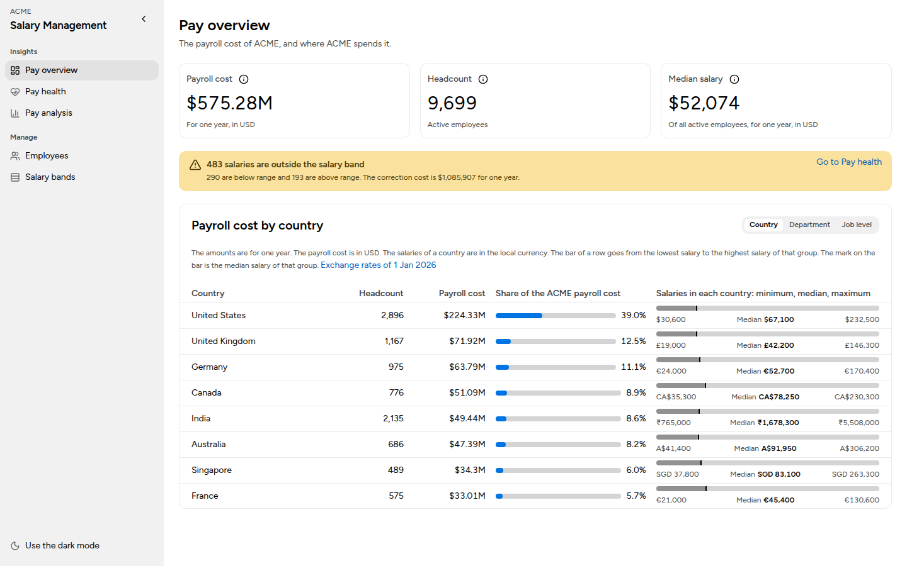

## The problem

The HR team of ACME keeps the salaries in Excel. An Excel file cannot answer a pay question, and it does not record when a salary changed, or why.

The HR Manager needs answers to 3 questions:

1. What does ACME pay, and where?
2. Who has a salary that is wrong for the job?
3. What does the correction cost?

So the product is not an employee list with a salary column. It is a tool for a pay decision.

## What the system does

The system follows the work of the HR Manager:

1. **See** the pay: payroll cost, headcount and median salary, by country, department and job level.
2. **Find** the problems: the salaries below or above the salary band, and the correction cost.
3. **Change** a salary, with a reason and an effective date. See the effect of a band change before the save.
4. **Prove** each change: each employee has a salary history that the system does not edit or delete.

All totals use one reporting currency (USD). Each salary converts at a dated exchange rate before the sum, and each amount is an integer in minor units.

## Screens

| | |
|---|---|
| 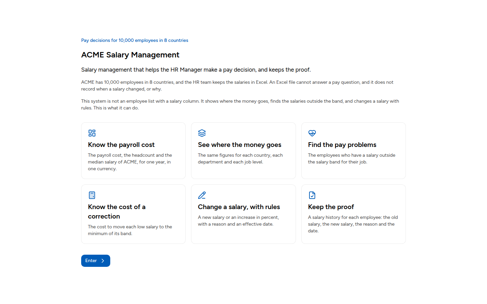 **Welcome.** The problem, and the 6 capabilities of the system. |  **Pay overview.** What ACME spends on salaries, and where. A notice links the salaries outside the band to Pay health. |
| 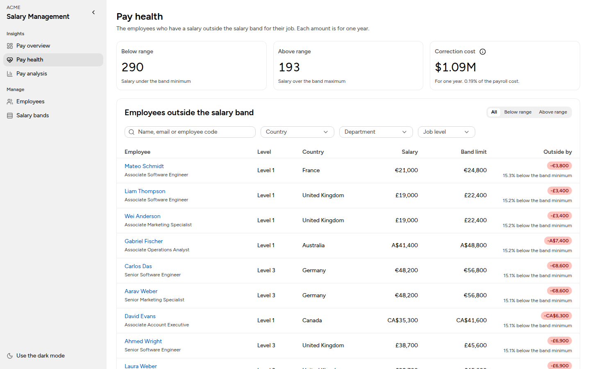 **Pay health.** Each employee below range or above range, worst case first. The correction cost, as an amount and as a share of the payroll cost. | 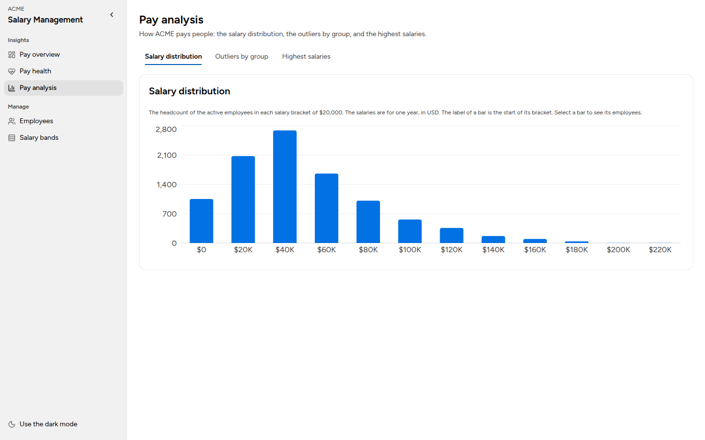 **Pay analysis: salary distribution.** The headcount in each salary bracket. A bar opens the list of its employees. |
| 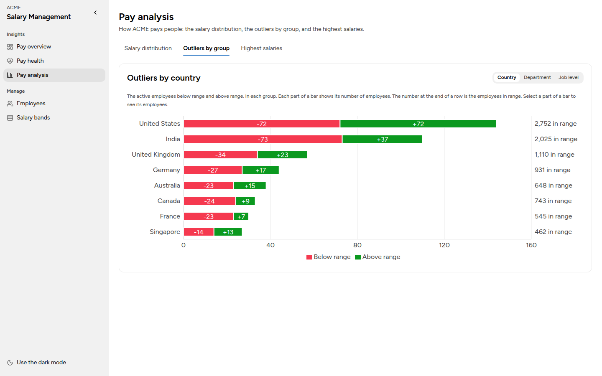 **Pay analysis: outliers by group.** The outliers of each country, department or job level, next to the employees in range. | 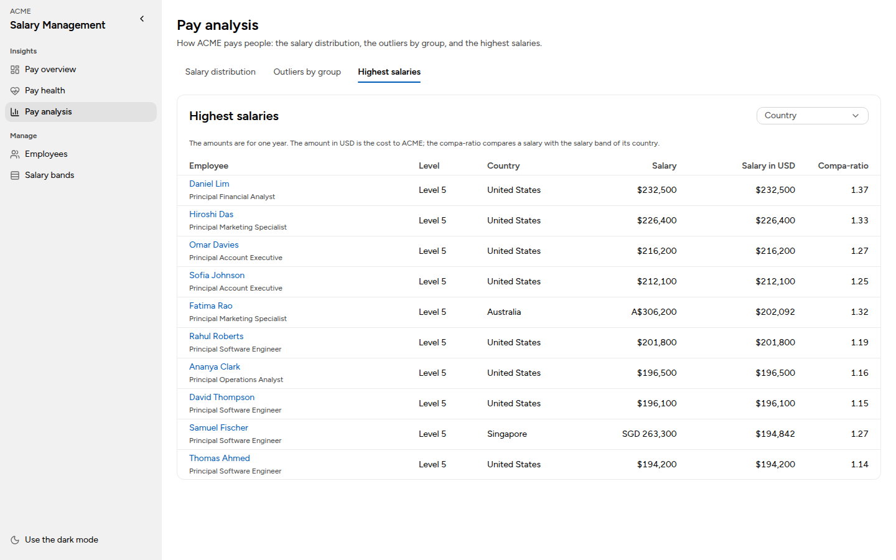 **Pay analysis: highest salaries.** The 10 highest salaries, in the local currency and in USD, with the compa-ratio. |
| 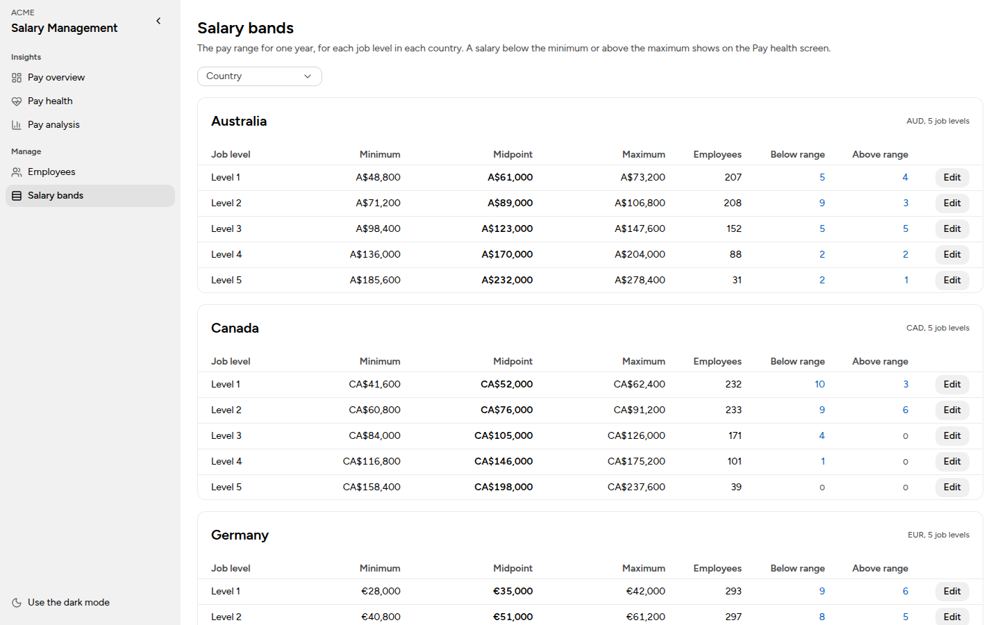 **Salary bands.** The pay range of each job level in each country, with its headcount and its outliers. | 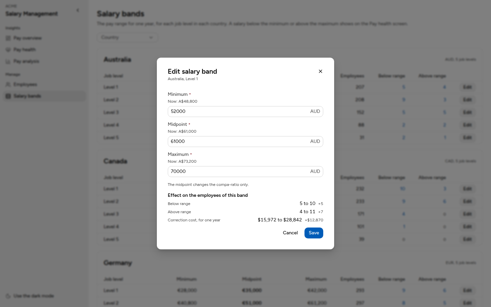 **Band change.** The effect of a new band on the outliers and the correction cost, before the save. |
| 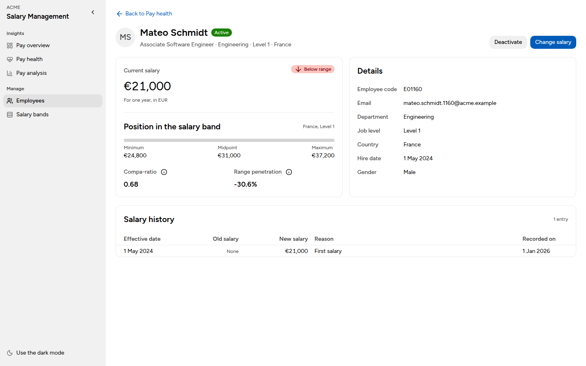 **Employee record.** The salary, its position in the band, the compa-ratio, the range penetration and the salary history. | 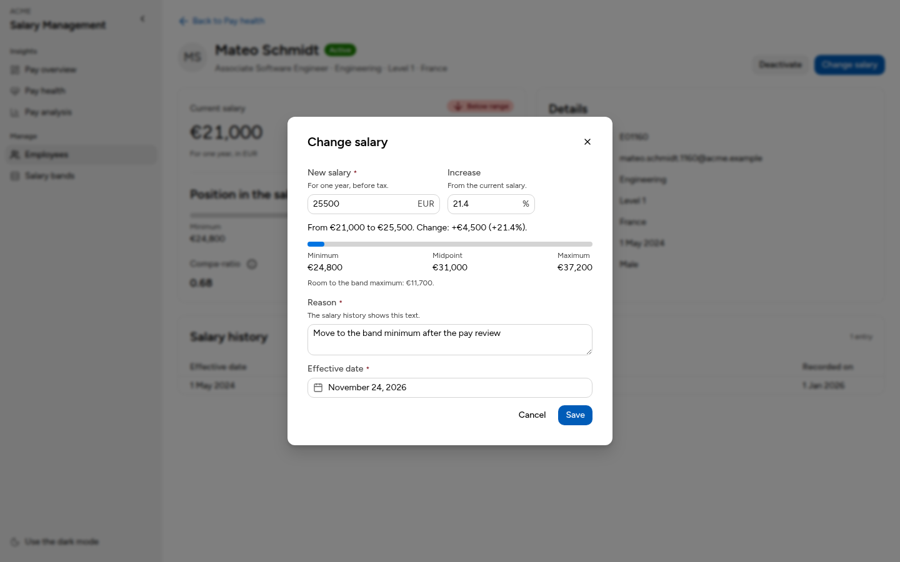 **Salary change.** A new salary or an increase in percent. The dialog shows the difference and the band before the save. |
| 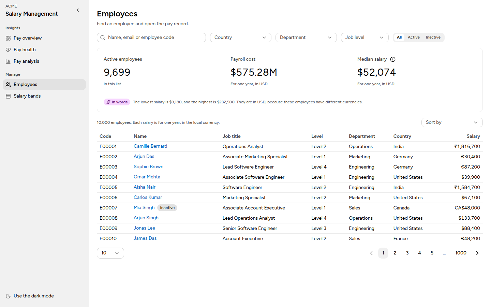 **Employees.** Search and filters. The list gives its headcount, payroll cost and median salary, so a filter answers a pay question. | 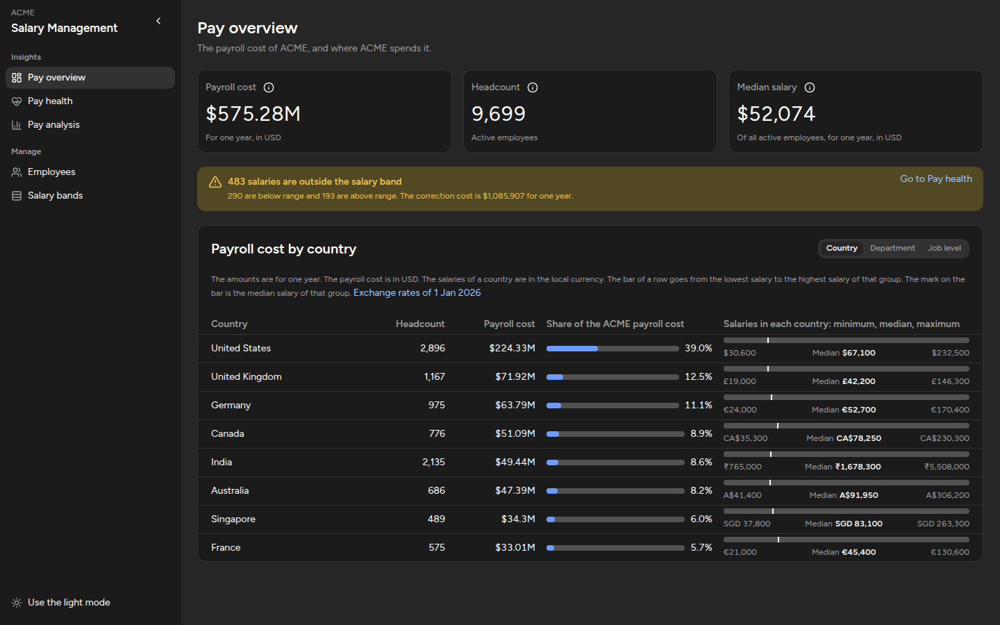 **Light and dark mode.** The mode follows the device, or the selection of the HR Manager. The charts follow the mode. |

| Screen | Question that it answers |
|---|---|
| Welcome | What is this system for? |
| Pay overview | What does ACME spend on salaries, and where? |
| Pay health | Who has a salary below or above the salary band? What does the correction cost? |
| Pay analysis | How many employees are in each salary bracket? Which group has the most outliers? Who has the highest salary? |
| Employees | What does ACME pay a group of employees, for example Engineering in Germany? What is the salary history of one employee? |
| Salary bands | What is the pay range for a job level in a country? What does a band change do, before the save? |
| Exchange rates | Which rates convert a salary to USD? The Pay overview links to this screen. |

## What the project shows

**Product judgment.**

- The scope is pay decisions, not employee administration. `docs/tradeoffs.md` gives each decision, its cost, and the features that the product leaves out.
- The salary band is the reference point for each insight. A salary alone has no meaning.
- A second iteration came from the use of the first version: the band preview, the Pay analysis screen, and a link from each chart bar to its employees.

**Correct money.**

- Each amount is an integer in minor units. No floating-point number holds money.
- Each salary converts to USD before the sum, and a half rounds up.
- The pay rules are pure functions, with no database, network or clock. Unit tests check them in isolation.

**Tests first, and traceable.**

- 269 backend tests (pytest) and 288 UI tests (Vitest and React Testing Library).
- Each requirement (`FR-nn`, `NFR-nn`) points to its slice and its tests in `docs/traceability.md`.
- Each test name describes a scenario, for example `refuses_a_salary_of_zero`.

**Measured performance.** With 10,000 employees, a list responds in less than 30 ms, and a pay insight in less than 60 ms. The requirements are 300 ms and 500 ms. `docs/performance.md` has the measurements.

**An accessible, consistent UI.**

- All screens use the Astryx design system and its theme tokens.
- Each screen has a loading state, an empty state and an error state, and works with a keyboard.
- Each chart has a table view for a screen reader.
- An explanation of each pay term opens from an info button.

**AI-assisted work, with a record.**

- An AI agent wrote most of the code, under rules in `CLAUDE.md` (the constitution).
- The developer made the product decisions and reviewed each screen in a browser.
- `docs/ai-usage.md` lists the 47 errors in the AI output that the build and 3 reviews found, each with its correction.

## Start

You need Python 3.12 or later with [uv](https://docs.astral.sh/uv/), and Node.js 22.

```
make start
```

This command does 4 steps:

1. It installs the dependencies.
2. It creates the database with 10,000 employees. Two runs give the same data.
3. It builds the UI.
4. It starts the system.

Then open http://localhost:8000. The API documentation is at http://localhost:8000/docs.

| Command | Result |
|---|---|
| `make start` | Install, seed, build and start |
| `make seed` | Create the database again with the same 10,000 employees |
| `make test` | Run the backend tests and the UI tests |
| `make lint` | Check the code style |
| `make dev-api` and `make dev-ui` | Start the API and the UI with reload, for development |

The live application runs on a free instance. The instance stops when no person uses it, so the first request can take up to 1 minute. A restart of the instance gives the seeded data again.

## Technology

- Backend: Python, FastAPI, SQLAlchemy, SQLite.
- UI: React 19, TypeScript, Vite, and the [Astryx](https://astryx.atmeta.com/) design system. Recharts draws the charts, with the colors of the Astryx theme.
- Tests: pytest, Vitest, React Testing Library. GitHub Actions runs the tests and the style checks on each push.

## Structure

```
backend/app/
  calculations/   pure pay calculations: money, salary bands, salary change rules
  services/       use cases and database queries
  routers/        HTTP endpoints
  seed.py         creates the 10,000 employees
frontend/src/
  components/     shared component library, built from Astryx components
  themes/         the Astryx neutral theme as source; `theme.ts` gives it a blue accent
  pages/          one directory for each screen
  api/            typed API client
  hooks/, lib/    shared hooks, formats and small pure functions
docs/             requirements, design notes, decisions and screenshots
```

## Documents

| Document | Content |
|---|---|
| [docs/requirements.md](docs/requirements.md) | Goal, scope, and the features that the product leaves out |
| [docs/glossary.md](docs/glossary.md) | The pay terms and the formulas |
| [docs/architecture.md](docs/architecture.md) | Diagram and main decisions |
| [docs/tradeoffs.md](docs/tradeoffs.md) | The choices and their cost, and the decisions that changed after the first version |
| [docs/performance.md](docs/performance.md) | Measured response times |
| [docs/traceability.md](docs/traceability.md) | Each requirement, with its slice and its tests |
| [docs/ai-usage.md](docs/ai-usage.md) | How the developer used AI: the requests, the decisions, and the errors in the AI output that the work found |
| [docs/demo-script.md](docs/demo-script.md) | A 5-minute walk through the system, with the figures to expect |
| [docs/specs/](docs/specs/) and [docs/plans/](docs/plans/) | Discovery, specification and plan, and the check of the brief in a browser |
| [.claude/DESIGN.md](.claude/DESIGN.md) | The design brief for the screens |
| [CLAUDE.md](CLAUDE.md) | The constitution: the rules for all work in this repository |

## Method

The project started from a take-home brief for a salary management tool. The work follows the workflow of [Bee](https://github.com/incubyte/ai-plugins/tree/main/bee), a Claude Code plugin:

1. Discovery
2. Specification
3. Plan
4. Vertical slices, with the tests first for most steps (`docs/ai-usage.md` lists the exceptions)
5. Review

The documents use the writing rules of ASD-STE100 Simplified Technical English.
